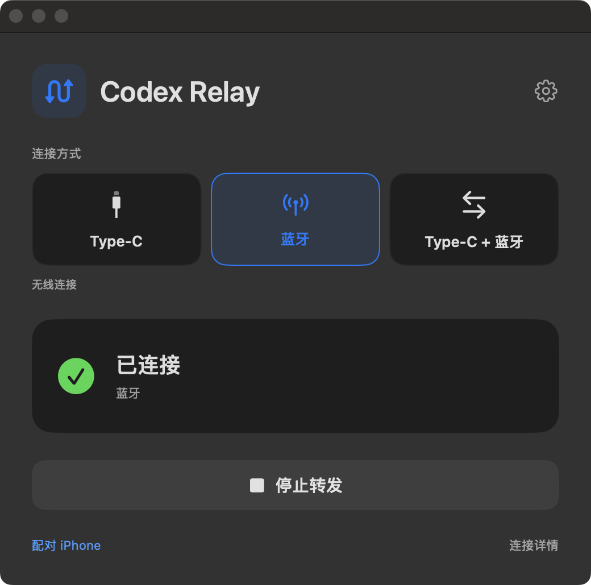
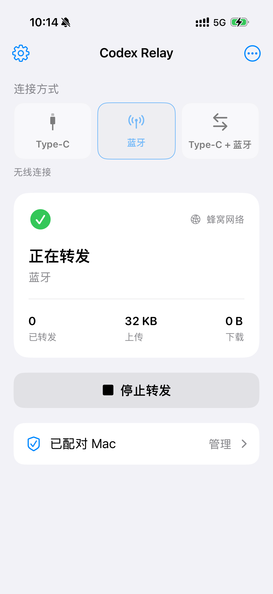

# Codex iPhone Relay

[简体中文](README.md) | **English**

Use Codex on a Mac without internet by relaying API requests through an online iPhone over USB-C or Bluetooth. Supports streaming responses and synced API settings.

**v1.5.1** · [Downloads](https://github.com/midisec/codex-iphone-relay/releases/tag/v1.5.1) · [Release notes (中文)](docs/releases/v1.5.1.md) · [Installation guide](docs/BINARY_INSTALL.en.md) · [MIT](LICENSE)

<table>
  <tr><th>macOS</th><th>iPhone</th></tr>
  <tr>
    <td valign="top"></td>
    <td valign="top"></td>
  </tr>
</table>

## Features

- USB-C (Type-C), Bluetooth, and USB-C + Bluetooth modes.
- A local API proxy compatible with the OpenAI Responses API.
- Edit API settings on either device and sync them on connection.
- SSE streaming, follow-up questions, and request cancellation.
- An isolated Codex 3 profile; only API traffic is relayed, with no Personal Hotspot required.

## Quick start

Prebuilt packages support **Apple Silicon Mac · macOS 13+ · iOS 16+**.

| Release file | Contents |
| --- | --- |
| [Mac installer](https://github.com/midisec/codex-iphone-relay/releases/download/v1.5.1/codex-relay-v1.5.1-macos-arm64.zip) | Mac installer with a bundled runtime; no compilation needed |
| [iPhone IPA](https://github.com/midisec/codex-iphone-relay/releases/download/v1.5.1/codex-relay-v1.5.1-ios-unsigned.ipa) | Prebuilt iPhone app; requires your own signing |
| [Source code](https://github.com/midisec/codex-iphone-relay/releases/download/v1.5.1/codex-relay-v1.5.1-source.zip) | Full source code and documentation |
| [SHA256SUMS](https://github.com/midisec/codex-iphone-relay/releases/download/v1.5.1/SHA256SUMS) | File checksums |

**Mac:** Install the Codex desktop app first. Extract the Mac package, open **Install.command**, and enter an existing API configuration directory such as `~/.codex-2`. Python and Xcode are not required. The package is not notarized; see the [installation guide](docs/BINARY_INSTALL.en.md) if macOS blocks it.

**iPhone:** Import the IPA into **AltStore Classic** for signing and installation, or use **Sign-iPhone.command** from the Mac package with your own development certificate. No compilation is needed. Developer Mode and a valid signature are required.

1. Open **Codex 3.app**, then click **配对 iPhone** (Pair iPhone) in the relay window.
2. On iPhone, open **Bluetooth Relay → 配对 Mac → 扫描二维码** (Pair Mac → Scan QR code) and save the pairing.
3. Select the same connection mode on both devices, then tap **开始转发** (Start relay) on iPhone.
4. Once connected and API settings show **已同步** (Synced), send a prompt in Codex 3.

Initial setup and signature renewal require internet access. During use, only the iPhone needs access to the API. The imported configuration must contain a Responses provider, model, and API key; ChatGPT login credentials cannot be imported. The current app UI is in Chinese.

## Connections and API settings

| Mode | Usage |
| --- | --- |
| Type-C | Keep the cable connected; uses the USB device channel through usbmuxd |
| Bluetooth | Uses BLE L2CAP; unplug the cable after pairing |
| Type-C + Bluetooth | Prefers USB, with Bluetooth for fallback and wake-up assistance |

Use the gear button on either device to edit the API URL, key, and model. Leave the key blank to keep the existing value.

| API source | Behavior |
| --- | --- |
| Automatic (default) | Uses the most recently saved settings; offline edits sync on reconnection |
| Computer | Uses the settings saved on the Mac |
| Phone | Uses the settings saved on the iPhone |

The iPhone must be able to reach your API endpoint. Tap **开始转发** again after updating the app. Start a new conversation after changing the model.

## Platforms and performance

Measured Bluetooth throughput with random data: **23.7–25.8 KiB/s**. Earlier USB-C tests recorded **4.7–21.7 MiB/s**. v1.5.1 reduces acknowledgment queueing; it has not demonstrated higher one-way bandwidth. See the [test results (中文)](docs/TESTING.md).

iOS limits background and lock-screen execution; long-running reliability still needs validation. Windows support is not implemented, and no Intel Mac package is available. See the [Windows status (中文)](docs/WINDOWS.md).

## Development

Building from source requires Swift / Xcode and Python 3.11+. See the source build guides for [Mac (中文)](docs/INSTALL.md) and [iPhone (中文)](iOS/INSTALL.md).

```bash
make check
make ios-build
```

Additional documentation (中文): [Packaging](docs/RELEASING.md) · [Protocol](docs/PROTOCOL.md) · [Contributing](CONTRIBUTING.md) · [Changelog](CHANGELOG.md)
