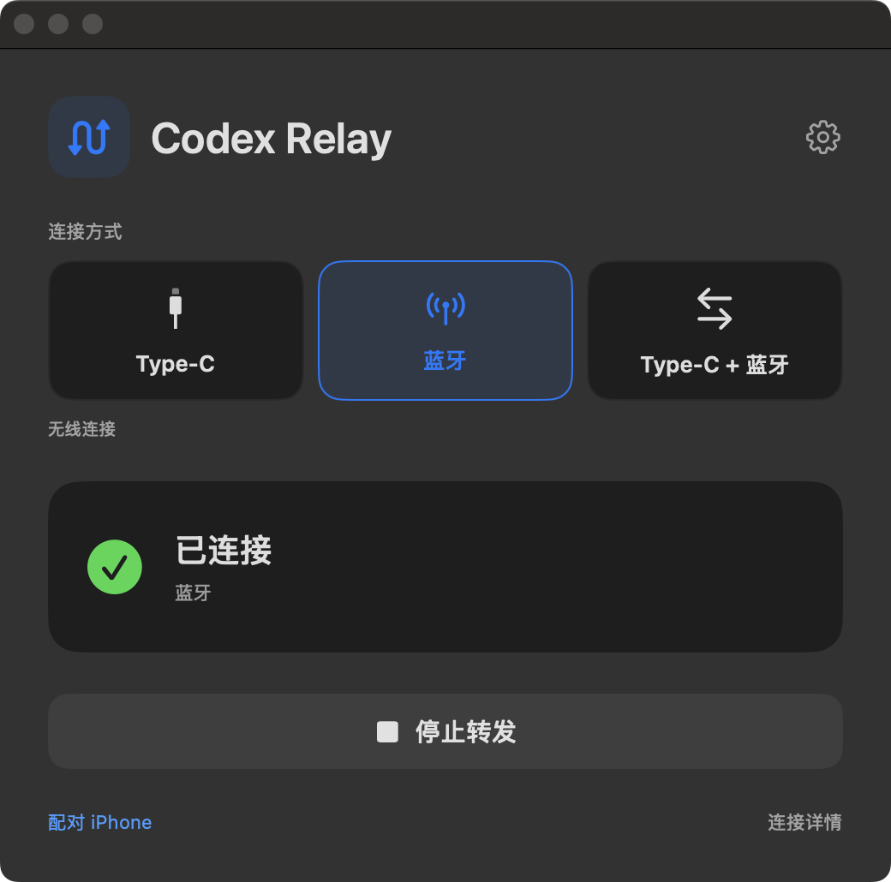
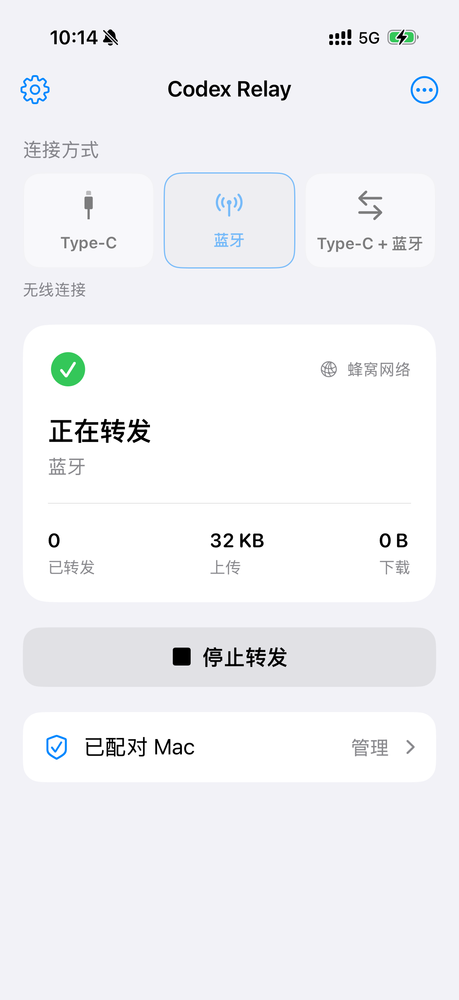

# Codex iPhone Relay

**简体中文** | [English](README.en.md)

通过 USB-C 或蓝牙，将 Mac 上的 Codex API 请求转发到联网的 iPhone。Mac 无需接入互联网，支持流式回复和双向 API 配置同步。

**v1.5.1** · [下载安装包](https://github.com/midisec/codex-iphone-relay/releases/tag/v1.5.1) · [版本说明](docs/releases/v1.5.1.md) · [使用教程](docs/USAGE.md) · [MIT](LICENSE)

<table>
  <tr><th>macOS</th><th>iPhone</th></tr>
  <tr>
    <td valign="top"></td>
    <td valign="top"></td>
  </tr>
</table>

## 功能

- USB-C（Type-C）/ 蓝牙 / USB-C + 蓝牙三种模式。
- 兼容 OpenAI Responses API 的本地 API 代理。
- Mac、iPhone 均可配置 API，连接后双向同步。
- SSE 流式回复、连续追问、取消请求。
- 独立 Codex 3 配置，只转发 API，无需开启个人热点。

## 快速开始

发布包适用 **Apple Silicon Mac · macOS 13+ · iOS 16+**。

| Release 文件 | 用途 |
| --- | --- |
| [Mac 安装包](https://github.com/midisec/codex-iphone-relay/releases/download/v1.5.1/codex-relay-v1.5.1-macos-arm64.zip) | Mac 免编译安装器，内置运行环境 |
| [iPhone IPA](https://github.com/midisec/codex-iphone-relay/releases/download/v1.5.1/codex-relay-v1.5.1-ios-unsigned.ipa) | iPhone 预编译 App，需自行签名 |
| [完整源码](https://github.com/midisec/codex-iphone-relay/releases/download/v1.5.1/codex-relay-v1.5.1-source.zip) | 完整源码与文档 |
| [SHA256SUMS](https://github.com/midisec/codex-iphone-relay/releases/download/v1.5.1/SHA256SUMS) | 文件校验值 |

Mac 已安装 Codex 桌面 App 后，解压 Mac 包，双击 **Install.command**，输入已有 API 配置目录，例如 `~/.codex-2`。无需 Python 或 Xcode。此包未公证，系统拦截时按 [安装教程](docs/BINARY_INSTALL.md) 允许打开。

iPhone 将 IPA 导入 **AltStore Classic** 签名安装；已有开发证书也可使用 Mac 包中的 **Sign-iPhone.command**。无需编译，需开发者模式及有效签名。见 [免编译安装](docs/BINARY_INSTALL.md)。

1. 打开 **Codex 3.app**，在转发窗口点击 **配对 iPhone**。
2. 手机打开 **Bluetooth Relay → 配对 Mac → 扫描二维码**，保存配对。
3. 两端选择相同连接模式，手机点击 **开始转发**。
4. 显示 **已连接**、API 配置 **已同步** 后，在 Codex 3 中提问。

首次安装及续签需联网；日常使用仅手机需要访问 API。源配置需包含 Responses provider、模型和 API key，不支持导入 ChatGPT 登录凭证。

## 连接与 API

| 模式 | 使用方式 |
| --- | --- |
| Type-C | 保持数据线连接，使用 USB 设备通道（usbmuxd） |
| 蓝牙 | 使用 BLE L2CAP，配对后可拔掉数据线 |
| Type-C + 蓝牙 | 优先有线，蓝牙备用及协助唤醒 |

两端点击齿轮，可编辑 API 地址、密钥和模型。密钥留空保留已有值。

| API 来源 | 生效规则 |
| --- | --- |
| 自动（默认） | 使用最近保存的一端，离线修改在重连后同步 |
| 电脑端 | 使用电脑端保存的配置 |
| 手机端 | 使用手机端保存的配置 |

手机需能访问目标 API。更新 App 后重新点击 **开始转发**；修改模型后新建会话。

## 平台与性能

本机实测：蓝牙随机数据 **23.7–25.8 KiB/s**；Type-C 历史记录 **4.7–21.7 MiB/s**。v1.5.1 优化确认包排队，未证明单向带宽提高。见 [测试记录](docs/TESTING.md)。

iOS 后台和锁屏连接受系统限制，长时间稳定性仍待验证。Windows 尚未实现，未提供 Intel Mac 安装包，见 [适配说明](docs/WINDOWS.md)。

## 开发

源码构建需要 Swift / Xcode 和 Python 3.11+，见 [Mac](docs/INSTALL.md) / [iPhone](iOS/INSTALL.md)。

```bash
make check
make ios-build
```

[打包 Release](docs/RELEASING.md) · [协议](docs/PROTOCOL.md) · [贡献](CONTRIBUTING.md) · [更新记录](CHANGELOG.md)
