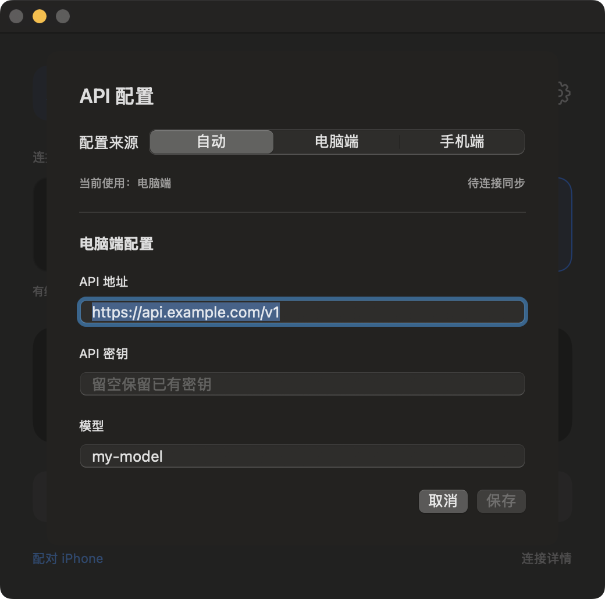

# 使用教程

适用版本：v1.5.1。

## 1. 安装

1. Mac 安装 Codex 桌面 App，解压 `codex-relay-v1.5.1-macos-arm64.zip`。
2. 双击 **Install.command**，输入已有 API 配置目录，例如 `~/.codex-2` 或 `~/.codex`。
3. 手机使用 **AltStore Classic** 导入 `codex-relay-v1.5.1-ios-unsigned.ipa` 签名安装；已有开发证书可使用 **Sign-iPhone.command**。
4. 用数据线连接并解锁 iPhone，点 **信任**。按提示开启 **开发者模式** 并信任开发者。

安装后，Mac 有 **Codex 3.app** 和 **Bluetooth Codex.app**，手机有 **Bluetooth Relay**。若手机提示未信任开发者，在 **设置 → 通用 → VPN 与设备管理** 中按提示信任。

安装器无需 Python 或 Xcode。签名流程与有效期见 [免编译安装](BINARY_INSTALL.md)。也可 [从源码构建 Mac](INSTALL.md) / [iPhone](../iOS/INSTALL.md)。

## 2. 配对连接

1. 打开 **Codex 3.app**，在转发窗口点击 **配对 iPhone**。
2. 手机打开 **Bluetooth Relay → 配对 Mac → 扫描二维码**，扫描 Mac 二维码并保存。
3. 允许蓝牙、相机和蜂窝数据权限；出现系统配对提示时，两端确认。
4. 两端选择相同模式，手机点击 **开始转发**，等待 **已连接**。

| 模式 | 操作 |
| --- | --- |
| Type-C | 保持数据线连接，无需个人热点 |
| 蓝牙 | 连接成功后可拔掉数据线 |
| Type-C + 蓝牙 | 保持蓝牙开启，有线优先、蓝牙备用 |

## 3. 设置 API

点击任一端齿轮，填写 **API 地址、API 密钥、模型**，选择来源并保存。

- **自动**：最近保存的一端生效。
- **电脑端 / 手机端**：固定使用对应端保存的配置。
- 密钥留空保留已有值；首次配置必须填写密钥。
- 等待 **已同步** 后发起新请求；已有回复继续传完。
- 修改模型后新建会话或重启 Codex 3。

## 4. 提问与停止

在 **Codex 3** 中提问，回复实时追加，可在同一会话继续追问。手机需能访问目标 API，Mac 的代理配置不会自动应用到手机。

结束时点击 **停止转发**。手机 App 更新或重启后，重新点击 **开始转发**，通常无需重新扫码。首次使用建议保持手机 App 在前台；后台和锁屏连接仍受 iOS 限制。

## 常见问题

| 现象 | 处理 |
| --- | --- |
| 手机已插线，仍未连接 | 解锁手机，确认设备信任、连接模式及“开始转发”状态 |
| API 返回 403 | 检查手机自身网络或代理能否访问 API |
| 无法继续追问 | 手机回到 App 前台，确认连接后重试 |
| 其他应用也通过手机联网 | 关闭系统热点或“iPhone USB”网络共享；本项目仅转发 API |
| 更新后 API 变了 | Mac 安装器会重新导入 `--source`；在齿轮中重新选择所需来源 |

[Mac 安装与诊断](INSTALL.md) · [iPhone 签名与安装](../iOS/INSTALL.md)
