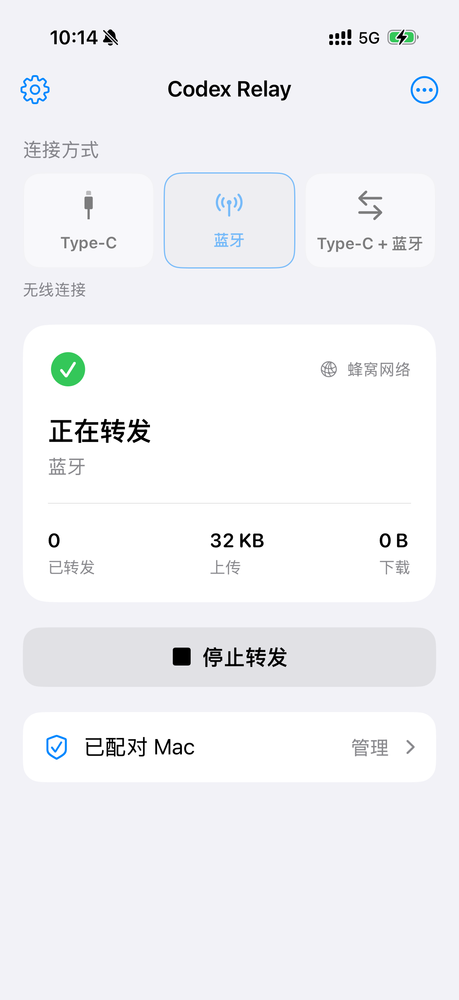

# iPhone 安装

预编译 IPA 的签名安装见 [免编译安装](../docs/BINARY_INSTALL.md)。以下为源码构建。

需要完整 Xcode、iOS 16+ 设备、数据线和 Apple 开发签名。Xcode 必须支持当前 Mac 和连接的 iPhone，见 [Apple Xcode 支持表](https://developer.apple.com/support/xcode/)。

## 准备

1. 首次打开 Xcode，完成组件安装，在 **Settings → Accounts** 登录 Apple Account。
2. 用数据线连接并解锁 iPhone，信任这台 Mac。
3. 按 Xcode 提示开启 **设置 → 隐私与安全性 → 开发者模式**，重启并确认。

## 安装

在仓库根目录运行：

```bash
python3 scripts/ios.py doctor
python3 scripts/ios.py install
```

脚本自动选择完整 Xcode 和唯一的开发团队，完成 Release 构建、签名、安装及启动。

| 参数 | 用途 |
| --- | --- |
| `--xcode /path/to/Xcode.app` | 指定 Xcode |
| `--team YOURTEAMID` | 指定 10 位开发团队 ID |
| `--device '设备名称'` | 多台设备时指定 iPhone |
| `--bundle-id com.example.BluetoothRelay` | 使用自己的唯一 Bundle ID |
| `--configuration Debug` | 安装调试构建 |

仅编译、不安装：`python3 scripts/ios.py build`。未签名的 `.app` 不能直接安装。签名有效期以 Xcode 和描述文件为准，到期后重新运行 `install`。

也可打开 `iOS/BluetoothRelay.xcodeproj`，选择 **BluetoothRelay → Signing & Capabilities → Automatically manage signing**，选择团队和设备，然后 Run。工程引用仓库根目录的 Swift Package，需保留完整目录结构。

## 配对

Mac 点击 **配对 iPhone**；手机打开 **配对 Mac → 扫描二维码**，保存后点击 **开始转发**。允许相机、蓝牙和蜂窝数据权限，两端选择相同模式。



## 常见问题

| 现象 | 处理 |
| --- | --- |
| 安装后无法启动 | 解锁设备，按系统提示信任开发者；检查签名是否有效 |
| 找不到开发团队 | 在 Xcode 登录账号，或通过 `--team` 指定 |
| 开发镜像不兼容 | 更新到支持该设备的 Xcode，完成平台组件安装 |
| 更新后未连接 | 重新打开 App，点击“开始转发”；通常无需重新扫码 |
| 已连接但 API 返回 403 | 检查手机网络能否访问 API，Mac 的代理不会自动应用到手机 |
| 后台或锁屏中断 | 回到前台重试；组合模式可使用蓝牙唤醒，但不能保证无限后台执行 |

### 旧 Xcode 的设备支持

脚本保留可选的 `pymobiledevice3` 开发镜像辅助流程：仅在 Apple 挂载错误 `12040` 且以下环境存在时启用，并再次由 Apple 工具校验镜像。该依赖只用于安装，不参与日常转发。

```bash
python3 -m venv .local/ios-tools
.local/ios-tools/bin/python -m pip install pymobiledevice3==11.18.0
python3 scripts/ios.py prepare-device
```

[pymobiledevice3 文档](https://github.com/doronz88/pymobiledevice3) · [Apple 真机运行说明](https://developer.apple.com/documentation/xcode/running-your-app-on-simulated-or-physical-devices)
